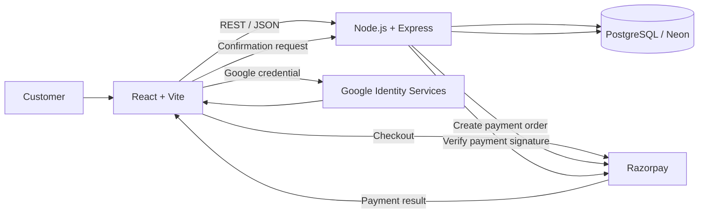

# Marvaelle — Full-Stack Fashion E-Commerce

A full-stack fashion e-commerce platform built with **React, Vite, Node.js, Express, and PostgreSQL**, featuring Google Sign-In, Razorpay payments, persistent inventory, order management, and newsletter subscriptions.

<p align="center">
  <a href="https://marvealle.vercel.app/"><strong>Live Storefront</strong></a>
  &nbsp; · &nbsp;
  <a href="https://marvaelle-backend.vercel.app/api/health"><strong>API Health</strong></a>
</p>

---

## Screenshots

### Storefront

<p align="center">
  
</p>

### Product Experience

<p align="center">
  
</p>

### Cart and Checkout

<p align="center">
  
</p>

### Responsive Design

<p align="center">
  
</p>

> Save your actual website screenshots under `docs/screenshots/` using the filenames referenced above. GitHub renders these images directly in the README.

---

## Features

### Shopping Experience
- Responsive fashion storefront and product catalogue.
- Shopping cart with product variant selection.
- Product and inventory data retrieved through backend APIs.
- Branded dialogs and validation feedback for user interactions.

### Authentication and Accounts
- Email and password authentication.
- Google Sign-In using Google Identity Services.
- JWT-based sessions and user profile retrieval.
- Authenticated order history.

### Payments and Order Management
- Razorpay Checkout integration.
- Server-side payment signature verification.
- PostgreSQL-backed orders and order items.
- Inventory updates during order confirmation.
- Order lookup and order-management endpoints.

### Newsletter
- Email validation and normalized subscriber addresses.
- Persistent newsletter subscriptions in PostgreSQL.
- Duplicate-safe subscriber storage.

**Newsletter scope:** The application stores newsletter opt-ins. Campaign delivery and unsubscribe management require a separate email delivery provider and are not currently implemented.

## Architecture



The frontend and backend are maintained in one repository and can be deployed independently. The frontend communicates with the backend through REST APIs, while PostgreSQL stores application data.

## Tech Stack

| Layer | Technologies |
| --- | --- |
| Frontend | React, Vite, React Router, Lucide, CSS |
| Backend | Node.js, Express 5 |
| Database | PostgreSQL, `pg`, Neon-compatible hosting |
| Authentication | Google Identity Services, JWT |
| Payments | Razorpay Checkout, server-side signature verification |
| Deployment | Vercel |
| Language | JavaScript |

## Repository Structure

```text
marvaelle/
├── frontend/
│   ├── public/
│   │   └── images/
│   ├── src/
│   ├── .env.example
│   ├── package.json
│   └── vercel.json
├── backend/
│   ├── migrations/
│   ├── src/
│   ├── .env.example
│   ├── package.json
│   └── DEPLOYMENT.md
├── docs/
│   └── screenshots/
│       ├── homepage.png
│       ├── product-page.png
│       ├── cart.png
│       └── mobile-view.png
├── .gitignore
└── README.md
```

## Getting Started

### Prerequisites

- Node.js 20 or newer.
- npm.
- A PostgreSQL database.
- Google OAuth Web application credentials for Google Sign-In.
- Razorpay credentials for payment integration.

Use a development database and Razorpay test credentials when developing locally.

### 1. Configure the Backend

From the repository root:

```bash
cd backend
npm install
```

Create a local environment file from the template.

**Windows PowerShell:**

```powershell
Copy-Item .env.example .env
```

**macOS/Linux:**

```bash
cp .env.example .env
```

Configure the environment variables described below, then apply the required SQL migrations to your development database.

Start the backend:

```bash
npm run dev
```

The default local API address is:

```text
http://localhost:3000
```

### 2. Configure the Frontend

Open a second terminal from the repository root:

```bash
cd frontend
npm install
```

Create your local environment file.

**Windows PowerShell:**

```powershell
Copy-Item .env.example .env
```

**macOS/Linux:**

```bash
cp .env.example .env
```

Configure `VITE_API_BASE_URL` to point to your local backend and set the public Razorpay Key ID.

Start the frontend:

```bash
npm run dev
```

Open the local URL printed by Vite.

## Environment Variables

### Frontend — `frontend/.env`

| Variable | Purpose |
| --- | --- |
| `VITE_API_BASE_URL` | Backend base URL, such as `http://localhost:3000` |
| `VITE_RAZORPAY_KEY_ID` | Public Razorpay Key ID used by Checkout |

### Backend — `backend/.env`

| Variable | Purpose |
| --- | --- |
| `PORT` | Local server port; defaults to `3000` in the local entry point |
| `DATABASE_URL` | PostgreSQL connection string |
| `JWT_SECRET` | Secret used to sign application session tokens |
| `GOOGLE_CLIENT_ID` | Google OAuth Web application Client ID |
| `RAZORPAY_KEY_ID` | Razorpay Key ID |
| `RAZORPAY_KEY_SECRET` | Private Razorpay API secret |

Google sign-in configuration is fetched from the backend; a separate `VITE_GOOGLE_CLIENT_ID` is not required by the current implementation.

**Security:** Variables prefixed with `VITE_` are exposed to the browser bundle. Never put database credentials, JWT secrets, or private payment keys in frontend environment variables. Do not commit actual `.env` files.

## Database Migrations

Database migrations are explicit and are not automatically applied during application startup. Apply them to the correct database before using features that depend on their tables or columns.

| Migration | Purpose |
| --- | --- |
| `001_marvaelle.sql` | Core user, order, order-item, and stock schema |
| `002_restore_current_catalog_inventory.sql` | Optional one-time inventory recovery |
| `003_order_item_variants.sql` | Adds size and colour to order items |
| `004_newsletter_subscribers.sql` | Creates the newsletter subscriber table |

**Important:** Migration `002_restore_current_catalog_inventory.sql` can overwrite quantities for listed products. Do not execute it after real sales without reviewing its effects.

For an existing database, inspect its schema and migration history before applying changes. Back up important data first.

## API Overview

| Method | Endpoint | Description |
| --- | --- | --- |
| GET | `/api/health` | Health and configuration status |
| GET | `/api/products` | Retrieve catalogue and stock data |
| POST | `/api/auth/signup` | Create an account |
| POST | `/api/auth/login` | Sign in with email and password |
| GET | `/api/auth/google/config` | Retrieve public Google sign-in configuration |
| POST | `/api/auth/google` | Verify a Google sign-in credential |
| GET | `/api/profile` | Retrieve the authenticated user's profile |
| GET | `/api/orders` | Retrieve the authenticated user's orders |
| POST | `/api/orders/create` | Create a payment order |
| POST | `/api/orders/confirm` | Verify payment and confirm an order |
| POST | `/api/newsletter/subscribe` | Save a newsletter opt-in |

Additional order lookup and order-management endpoints are implemented in `backend/src/index.js`.

## Deployment

The application supports separate frontend and backend deployments on Vercel.

### Frontend

1. Connect the repository to a Vercel project.
2. Set the Root Directory to `frontend`.
3. Configure `VITE_API_BASE_URL` with the deployed backend origin, without an `/api` suffix.
4. Configure `VITE_RAZORPAY_KEY_ID` with the public payment key.
5. Deploy and test the storefront.

### Backend

1. Connect the same repository to a separate Vercel project.
2. Set the Root Directory to `backend`.
3. Configure `DATABASE_URL`, `JWT_SECRET`, `GOOGLE_CLIENT_ID`, `RAZORPAY_KEY_ID`, and `RAZORPAY_KEY_SECRET`.
4. Apply the required database migrations to the intended production database.
5. Deploy and verify the API health endpoint.

After deployment, test authentication, product and inventory retrieval, checkout, payment verification, order history, and newsletter signup.

See `backend/DEPLOYMENT.md`, `frontend/DEPLOYMENT.md`, and `frontend/CHECKOUT_TESTING.md` for additional project-specific instructions where present.

## Validation

Run the checks before pushing changes.

**Backend syntax checks:**

```bash
cd backend
npm run check
```

**Frontend production build:**

```bash
cd frontend
npm run build
```

Commit the lockfiles generated by npm in both application directories so dependencies can be installed reproducibly. Do not commit `node_modules/` or generated build output.

## Security

- Never commit `.env` files, database connection strings, private keys, or customer data.
- Keep `JWT_SECRET` and `RAZORPAY_KEY_SECRET` exclusively on the backend.
- Verify payment signatures on the server before confirming an order.
- Use test payment credentials during development.
- Review authorization and validation on all order-management endpoints.
- Confirm you have permission to publish product images, branding, and other third-party assets before making the repository public.

## Future Improvements

Potential enhancements include:

- Newsletter campaign delivery and unsubscribe management.
- Product reviews and ratings.
- Product search, filtering, and sorting.
- Automated API and checkout integration tests.
- CI checks for pull requests and production builds.
- Structured logging and monitoring for payment and order workflows.

---

**Built as a full-stack engineering project**, demonstrating frontend development, REST API integration, authentication, payment workflows, relational data persistence, and cloud deployment.
