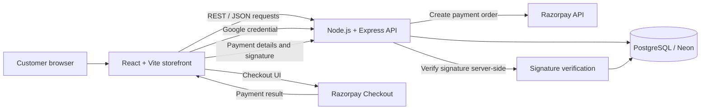

# Marvaelle — Full-Stack Fashion E-Commerce

A full-stack fashion e-commerce storefront built with **React, Vite, Node.js/Express, and PostgreSQL**. It includes account sign-in, product and inventory flows, Razorpay checkout, order history, and persistent newsletter signups.

<p align="center">
  <a href="https://marvealle.vercel.app/"><strong>Live Storefront</strong></a>
  &nbsp; · &nbsp;
  <a href="https://marvaelle-backend.vercel.app/api/health"><strong>API Health</strong></a>
</p>

---

## Website Screenshots

The images are committed under `marvaelle/docs/screenshots/`. These use GitHub-flavoured Markdown image links (not raw HTML `` tags), so GitHub resolves the relative paths from the repository root.

| **Homepage / Hero** | **Current Collection** |
| --- | --- |
|  |  |
| **Editorial Section** | **Signup / Dialog View** |
| --- | --- |
|  |  |
| **Shopping Bag** | **Checkout** |
| --- | --- |
|  |  |
| **Product / Store View** | **Shopping Bag / Order Summary** |
| --- | --- |
|  |  |
| **Account / Form Flow** |  |
| --- | --- |
|  |  |
---

## Features

### Storefront
- Responsive fashion storefront and product catalogue.
- Shopping cart and product variant selection.
- Product and inventory data fetched through backend APIs.
- Branded dialogs and form feedback.

### Authentication and Accounts
- Email/password authentication.
- Google Sign-In with Google Identity Services.
- JWT-based sessions and profile retrieval.
- Authenticated order history.

### Payments and Orders
- Razorpay Checkout integration.
- Server-side payment signature verification.
- PostgreSQL-backed orders and order items.
- Inventory updates during order confirmation.
- Order lookup and order-management endpoints.

### Newsletter
- Email validation and normalized subscriber addresses.
- Persistent newsletter signup storage in PostgreSQL.
- Duplicate-safe subscriber storage.

**Newsletter scope:** The application stores newsletter opt-ins. Automated campaign delivery and unsubscribe management require a separate email delivery provider and are not currently included.

## Architecture



The frontend and backend live in the same repository but can be deployed as separate Vercel projects. The frontend communicates with the Express API, while PostgreSQL stores application data.

## Tech Stack

| Layer | Technologies |
| --- | --- |
| Frontend | React, Vite, React Router, Lucide icons, CSS |
| Backend | Node.js, Express 5, `pg`, `hash-wasm` |
| Database | PostgreSQL, `pg`, Neon-compatible hosting |
| Authentication | Google Identity Services, JWT |
| Payments | Razorpay Checkout, server-side signature verification |
| Deployment | Vercel |
| Language | JavaScript |

## Repository Structure

```text
Marvealle_Fashion_Atlier/
├── README.md
├── LICENSE
└── marvaelle/
    ├── frontend/
    │   ├── public/images/        # Storefront product imagery
    │   ├── src/                  # React UI, API client, styles and catalogue data
    │   ├── .env.example
    │   ├── package.json
    │   └── vercel.json
    ├── backend/
    │   ├── migrations/           # Explicit SQL schema changes
    │   ├── src/                  # Express routes, auth and database access
    │   ├── .env.example
    │   └── package.json
    ├── docs/
    │   └── screenshots/          # Website screenshots embedded above
    └── .gitignore
```

## Run Locally

### Prerequisites

- Node.js 20 or newer and npm.
- A PostgreSQL development database.
- Google OAuth Web application credentials for Google Sign-In.
- Razorpay credentials for checkout testing.

Use a development database and Razorpay test credentials while developing locally.

### 1. Configure the backend

```bash
cd marvaelle/backend
npm install
```

From `marvaelle/backend/`, copy `.env.example` to `.env` and fill in the local values. On Windows PowerShell, run `Copy-Item .env.example .env`; on macOS/Linux, run `cp .env.example .env`.

Apply the required SQL migrations to the database configured by `DATABASE_URL`, then start the backend:

```bash
npm run dev
```

The local API uses `http://localhost:3000` by default.

### 2. Configure the frontend

Open a second terminal from the repository root, then enter the frontend directory:

```bash
cd marvaelle/frontend
npm install
```

From `marvaelle/frontend/`, copy `.env.example` to `.env`. Set `VITE_API_BASE_URL` to your local backend origin and set `VITE_RAZORPAY_KEY_ID` to the public Razorpay Key ID matching the backend configuration.

```bash
npm run dev
```

Open the local URL printed by Vite.

## Environment Variables

### Frontend — `marvaelle/frontend/.env`

| Variable | Purpose |
| --- | --- |
| `VITE_API_BASE_URL` | Backend base URL, for example `http://localhost:3000` locally. |
| `VITE_RAZORPAY_KEY_ID` | Public Razorpay Key ID used by Checkout. |

### Backend — `marvaelle/backend/.env`

| Variable | Purpose |
| --- | --- |
| `PORT` | Local server port; defaults to `3000` in the local entry point. |
| `DATABASE_URL` | PostgreSQL connection string. |
| `JWT_SECRET` | Secret used to sign application session tokens. |
| `GOOGLE_CLIENT_ID` | Google OAuth Web application Client ID. |
| `RAZORPAY_KEY_ID` | Razorpay Key ID used by the backend. |
| `RAZORPAY_KEY_SECRET` | Private Razorpay API secret; backend only. |

`VITE_*` variables are exposed in the browser bundle and must never contain secrets. Google sign-in configuration is fetched from the backend, so the current implementation does not require a separate `VITE_GOOGLE_CLIENT_ID`.

## Database Migrations

Migrations are explicit and are **not automatically applied at application startup**. Apply them to the intended PostgreSQL database before using features that depend on their tables or columns.

| Migration | Purpose |
| --- | --- |
| `001_marvaelle.sql` | Core user, order, order-item and stock schema. |
| `002_restore_current_catalog_inventory.sql` | Optional one-time inventory recovery; can overwrite listed product quantities. |
| `003_order_item_variants.sql` | Adds size and colour to order items. |
| `004_newsletter_subscribers.sql` | Creates the newsletter subscriber table. |

For an existing database, inspect the current schema and migration history first. Back up important data before making changes, and do not run the inventory-recovery migration after real sales without reviewing its effects.

## API Overview

| Method | Endpoint | Purpose |
| --- | --- | --- |
| `GET` | `/api/health` | Health and configuration status. |
| `GET` | `/api/products` | Product catalogue and stock data. |
| `POST` | `/api/auth/signup` | Create an account. |
| `POST` | `/api/auth/login` | Email/password sign-in. |
| `GET` | `/api/auth/google/config` | Return public Google sign-in configuration. |
| `POST` | `/api/auth/google` | Verify a Google sign-in credential. |
| `GET` | `/api/profile` | Read the signed-in user's profile. |
| `GET` | `/api/orders` | Read the signed-in user's orders. |
| `POST` | `/api/orders/create` | Create a payment order. |
| `POST` | `/api/orders/confirm` | Verify payment and confirm an order. |
| `POST` | `/api/newsletter/subscribe` | Store a newsletter opt-in. |

Additional order lookup and order-management routes are implemented in `marvaelle/backend/src/index.js`.

## Deploy on Vercel

The frontend and backend are separate Vercel projects using this same repository.

### Frontend project

1. Set **Root Directory** to `marvaelle/frontend`.
2. Configure `VITE_API_BASE_URL` to the deployed backend origin, without an `/api` suffix.
3. Configure `VITE_RAZORPAY_KEY_ID` with the public Razorpay Key ID.
4. Deploy and test the storefront.

### Backend project

1. Set **Root Directory** to `marvaelle/backend`.
2. Configure `DATABASE_URL`, `JWT_SECRET`, `GOOGLE_CLIENT_ID`, `RAZORPAY_KEY_ID`, and `RAZORPAY_KEY_SECRET` in Vercel Environment Variables.
3. Apply the required migrations to the production database used by `DATABASE_URL`.
4. Deploy and verify the API health endpoint.

After deployment, test Google Sign-In, product and inventory retrieval, checkout, server-side payment verification, order history, and newsletter signup. See `marvaelle/backend/DEPLOYMENT.md`, `marvaelle/frontend/DEPLOYMENT.md`, and `marvaelle/frontend/CHECKOUT_TESTING.md` for additional project-specific notes where present.

## Validation

Run these checks before pushing changes:

Backend syntax checks (run from the repository root):

```bash
cd marvaelle/backend
npm run check
```

Frontend production build (run from the repository root, in a separate terminal):

```bash
cd marvaelle/frontend
npm run build
```

Commit the npm lockfiles from both application directories to make dependency installation more reproducible. Do not commit `node_modules/` or generated build output.

## Security Notes

- Never commit `.env` files, database credentials, private keys, customer information or production database exports.
- Keep `JWT_SECRET` and `RAZORPAY_KEY_SECRET` on the backend only.
- Validate payment signatures on the server before confirming orders.
- Use test payment credentials during development.
- Review authorization and validation for order-management endpoints.
- Confirm that you have permission to publish all product images, branding and third-party media before making the repository public.

## Potential Improvements

- Newsletter campaign delivery and unsubscribe management.
- Product reviews, ratings, search and filtering.
- Automated API and checkout integration tests.
- CI checks for pull requests and production builds.
- Structured logging and monitoring for order and payment workflows.

---

Built as a full-stack engineering project demonstrating frontend development, REST API integration, authentication, payment workflows, relational data persistence and cloud deployment.
