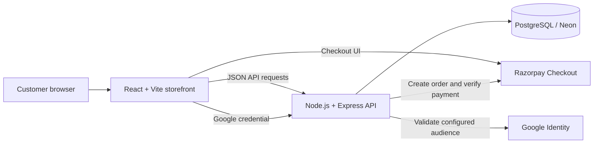

# Marvaelle

A full-stack fashion e-commerce storefront built with React, Vite, Node.js/Express, and PostgreSQL. The application includes account sign-in, product and inventory flows, Razorpay checkout, order history, and a persisted newsletter signup form.

> **Portfolio note:** Before publishing, replace the demo URL placeholders below with your live storefront and API URLs, and add screenshots captured from the working site.

**Live storefront:** `ADD_YOUR_STOREFRONT_URL`  
**API health:** `ADD_YOUR_BACKEND_URL/api/health`

## Features

- Responsive storefront and product catalogue.
- Cart and product variant selection.
- Email/password accounts and Google sign-in.
- Razorpay checkout with server-side payment signature verification.
- PostgreSQL-backed user profiles, order records, inventory, and order history.
- Inventory updates during order confirmation.
- Order-status endpoints for the order-management workflow.
- Newsletter signups validated and persisted in PostgreSQL.
- Shared branded dialogs with keyboard and focus handling.

**Newsletter scope:** The signup form stores opt-in email addresses. Sending campaigns and unsubscribe management require a separate email delivery provider and are not currently included.

## Architecture



The frontend and backend can be deployed as separate Vercel projects from this monorepo: set the frontend project's **Root Directory** to `frontend`, and the backend project's **Root Directory** to `backend`.

## Tech stack

- **Frontend:** React, Vite, React Router, Lucide icons, CSS.
- **Backend:** Node.js 20+, Express 5, PostgreSQL via `pg`, JWT-based sessions, `hash-wasm` password hashing/verification support.
- **Integrations:** Google Identity Services and Razorpay.
- **Hosting/database:** Vercel and PostgreSQL (Neon is supported).

## Repository structure

```text
marvaelle/
├── frontend/
│   ├── public/images/        # Storefront product imagery
│   ├── src/                  # React UI, API client, styles, catalogue data
│   ├── .env.example          # Frontend environment template
│   ├── package.json
│   └── vercel.json
├── backend/
│   ├── migrations/           # Explicit SQL schema changes
│   ├── src/                  # Express routes, auth and database access
│   ├── .env.example          # Backend environment template
│   └── package.json
├── .gitignore
└── README.md
```

## Run locally

Requirements: Node.js 20 or newer, npm, and a PostgreSQL database. Use a development database—not production—while experimenting locally.

### 1. Configure the backend

```bash
cd backend
npm install
```

Copy `backend/.env.example` to `backend/.env` and replace the placeholder values. Use PowerShell on Windows with `Copy-Item .env.example .env`, or macOS/Linux with `cp .env.example .env` when your current directory is `backend`.

Apply the needed SQL migrations to the database named in `DATABASE_URL` before starting the application. Then run:

```bash
npm run dev
```

The local API runs on `http://localhost:3000` by default.

### 2. Configure and run the frontend

In a second terminal:

```bash
cd frontend
npm install
```

Copy `frontend/.env.example` to `frontend/.env`. The default `VITE_API_BASE_URL` points to the local API. Set `VITE_RAZORPAY_KEY_ID` to the same **public Key ID** configured as `RAZORPAY_KEY_ID` on the backend.

```bash
npm run dev
```

Vite prints the local storefront URL in the terminal.

## Environment variables

### Frontend (`frontend/.env`)

| Variable | Purpose |
| --- | --- |
| `VITE_API_BASE_URL` | Base URL for the Express API, e.g. `http://localhost:3000` locally. |
| `VITE_RAZORPAY_KEY_ID` | Public Razorpay Key ID used by Checkout; must match the backend Key ID. |

### Backend (`backend/.env`)

| Variable | Purpose |
| --- | --- |
| `PORT` | Local server port; defaults to `3000` in the local entry point. |
| `DATABASE_URL` | PostgreSQL connection string. |
| `JWT_SECRET` | Secret used to sign application session tokens. |
| `GOOGLE_CLIENT_ID` | Google OAuth **Web application** Client ID used to validate Google credentials. |
| `RAZORPAY_KEY_ID` | Razorpay Key ID used by the backend to create orders. |
| `RAZORPAY_KEY_SECRET` | Secret Razorpay API credential; backend only. |

`VITE_*` variables are included in the browser bundle and must never contain secrets. Do not put `DATABASE_URL`, `JWT_SECRET`, or `RAZORPAY_KEY_SECRET` in the frontend environment. Google configuration is fetched from the backend; a separate `VITE_GOOGLE_CLIENT_ID` is not needed by this code.

## Database migrations

Migrations are explicit and are **not automatically applied at application startup**. Apply them to the intended PostgreSQL database using your provider's SQL editor or an approved migration workflow.

- `001_marvaelle.sql` — core user, order, order-item, and stock schema; seeds stock only for absent rows.
- `002_restore_current_catalog_inventory.sql` — **optional one-time recovery only** if launch inventory needs to be restored. It overwrites quantities for listed products. Do not run after real sales.
- `003_order_item_variants.sql` — adds size and colour to order items.
- `004_newsletter_subscribers.sql` — creates the newsletter subscriber table.

For an existing production database, inspect the current schema and migration history first; don't blindly rerun the inventory-recovery migration. Back up data before making schema changes.

## API overview

| Method | Endpoint | Purpose |
| --- | --- | --- |
| `GET` | `/api/health` | Health and configuration status. |
| `GET` | `/api/products` | Product catalogue and stock data. |
| `POST` | `/api/auth/signup` | Create an account. |
| `POST` | `/api/auth/login` | Email/password sign-in. |
| `GET` | `/api/auth/google/config` | Return public Google sign-in configuration. |
| `POST` | `/api/auth/google` | Verify Google sign-in credential. |
| `GET` | `/api/profile` | Read the signed-in user's profile. |
| `GET` | `/api/orders` | Read the signed-in user's orders. |
| `POST` | `/api/orders/create` | Create a payment order. |
| `POST` | `/api/orders/confirm` | Verify payment and confirm an order. |
| `POST` | `/api/newsletter/subscribe` | Store a newsletter opt-in. |

Additional order lookup and order-management routes are implemented in `backend/src/index.js`.

## Deployment on Vercel

1. Push this repository to GitHub.
2. Create or connect the frontend Vercel project and set **Root Directory** to `frontend`.
3. Create or connect the backend Vercel project and set **Root Directory** to `backend`.
4. Configure the appropriate environment variables in each project's Vercel settings. Do not commit actual values.
5. Confirm required database migrations have been applied to the database referenced by the backend's `DATABASE_URL`.
6. Deploy the backend and verify `/api/health`; set `VITE_API_BASE_URL` on the frontend to the deployed backend origin (without an `/api` suffix), then deploy the frontend.
7. Test Google sign-in with the correct Web application Client ID and authorized storefront origin. Test checkout with Razorpay test credentials before accepting real payments.

See `backend/DEPLOYMENT.md` and `frontend/DEPLOYMENT.md` for project-specific deployment notes, and `frontend/CHECKOUT_TESTING.md` for checkout checks.

## Validation commands

```bash
# Backend syntax checks
cd backend && npm run check

# Frontend production build
cd frontend && npm run build
```

Run these locally before pushing changes. Add/commit the generated `package-lock.json` files from both app folders so installs are repeatable; do not commit `node_modules/` or build output.

## Security and contribution notes

- Never commit `.env`, credentials, database URLs, private keys, customer data, or production database exports.
- Keep Razorpay's secret key and the JWT secret on the backend only.
- Use test payment credentials for development and validate payment on the server.
- Verify that you have permission to publish all product images, brand assets, and other media in this public repository.
- Keep pull requests small and describe what changed and how it was tested.
